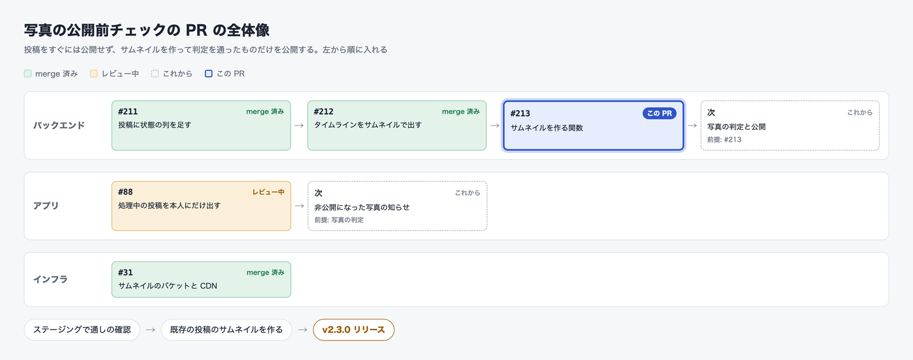
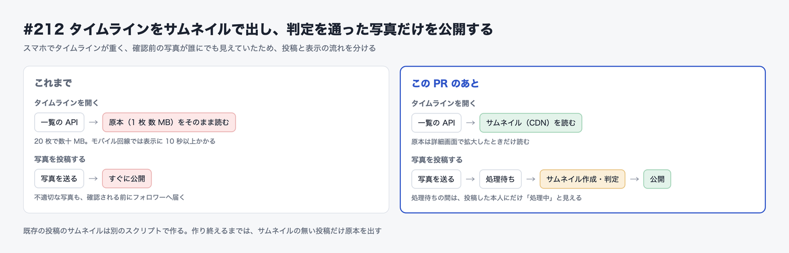
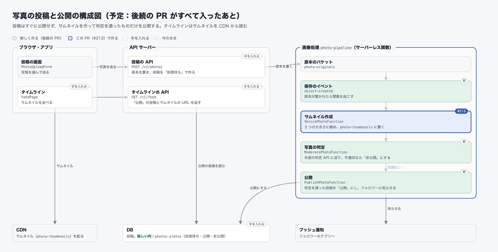
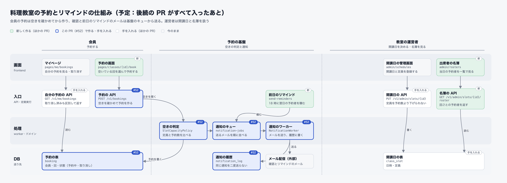

# pr-figures

PR の本文に貼る図を、HTML から PNG に描いて貼るための [Agent Skill](https://docs.claude.com/en/docs/claude-code/skills)（Claude Code などで使える）。

レビュアーが本文を読む前に、次の 3 つを 1 枚ずつで掴めるようにする。

| 図 | 中身 |
|---|---|
| 概要の図 | この PR が変えること（これまで／このあと、項目の表、番号つきの手順の 3 つの型） |
| 全体像の図 | 同じタスクの PR をリポジトリごとに並べ、この PR の位置を強調する |
| 構成図 | 機能を構成するコンポーネントを箱にし、呼び出しとデータの流れを矢印でつなぐ |

図は HTML で組み、Chrome の headless で PNG にする。画像生成と違って文字が崩れず、事実を直しやすい。

## 例

全体像の図（`scripts/roadmap.py` が JSON から作る）



概要の図（`examples/before-after.html`）



構成図・列 ＝ 実行する場所（`examples/components.html`）



構成図・層 × 担当する側（`examples/components-layered.html`）



ほかの型: [項目の表と使い道](docs/images/api-field.png)・[番号つきの手順](docs/images/numbered-steps.png)

例の中身はすべて架空のもの。

## 入れ方

```sh
git clone https://github.com/yamatechi/pr-figures ~/.claude/skills/pr-figures
```

プロジェクトだけで使うなら `<リポジトリ>/.claude/skills/pr-figures` に置く。

必要なもの:

- Python 3 と Pillow（`pip install pillow`）
- Google Chrome または Chromium（場所が既定と違うときは環境変数 `CHROME_PATH`）
- [GitHub CLI](https://cli.github.com/)（`gh auth login` 済み。PR に貼るときだけ）

## 使い方

エージェントに「この PR に図を貼って」「構成図を作って」と頼む。手順は [SKILL.md](SKILL.md) にある。

スクリプトを直接使うこともできる。

```sh
# 全体像の図: roadmap.json の current に並べた PR ごとに roadmap-<番号>.html を書く
python3 scripts/roadmap.py pr-figs/roadmap.json pr-figs/

# HTML を PNG にする（2 倍の解像度、下の余白を切り詰める）
python3 scripts/render.py pr-figs/*.html

# PR の本文の先頭に「## 図」の節を作り、画像を上げて貼る
python3 scripts/attach.py <owner/repo> <PR 番号> pr-figs/overview-123.png pr-figs/roadmap-123.png \
  --alt "この PR の概要" --alt "PR の全体像（この PR の位置）"
```

## 構成

```
SKILL.md                         手順と描き方の決まり
scripts/roadmap.py               全体像の図を JSON から作る
scripts/render.py                HTML → PNG（Chrome headless）
scripts/attach.py                PR の本文に画像を上げて貼る
assets/*.css, assets/arrows.js   部品の見た目と、構成図の矢印を箱の位置から引くスクリプト
examples/                        概要の図と構成図の雛形
```

## ライセンス

[MIT](LICENSE)
